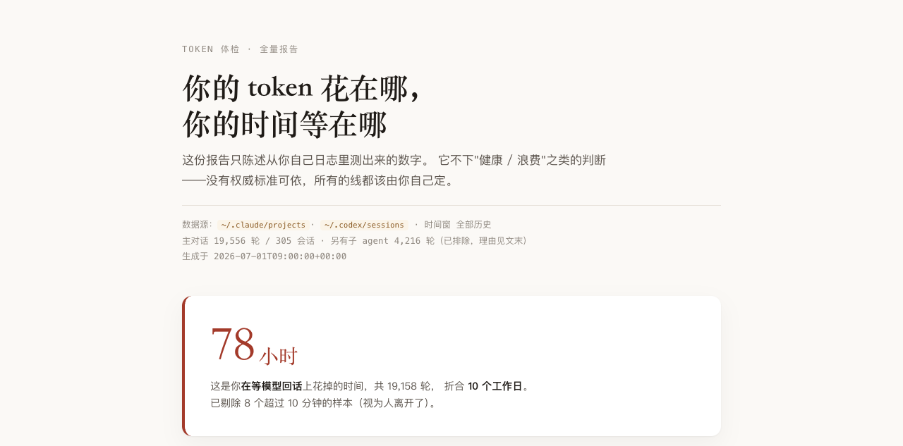

# token-checkup

给自己的 AI 使用习惯做一次 token 体检。

扫描本机 Claude Code / Codex 的对话日志，算清 **token 花在哪、时间等在哪**，
产出一份 HTML 报告。**全程本机运行，不上传任何数据。**

> **English**: A local-only audit of your Claude Code / Codex usage habits.
> It scans your conversation logs, separates the token cost you *can* change from the
> cost that's architecturally unavoidable, and renders an HTML report — with a built-in
> checklist of 9 real measurement mistakes so the analysis doesn't fool you.
> No dependencies beyond Python 3.8+. Nothing leaves your machine.



完整示例（合成数据，非任何人的真实统计）：[examples/example-report.html](examples/example-report.html)

---

## 它和别的"token 统计工具"有什么不同

大多数工具告诉你"你用了多少 token"。这个工具试图回答一个更难的问题：
**这些消耗里，有多少是你能改的？**

为此它做了三件不常见的事：

**1. 给出分母。**
"86% 的开销花在重读历史上"——这句话其实没有意义，因为模型每一轮都必须重读全部历史，
这是架构决定的。本工具会算出**理论下限**（假设你每轮都开新对话，最少要重读多少），
只有超出下限的部分才是行为造成的。

**2. 不下判断。**
不会告诉你"上下文超过 X 就不健康"——因为没有任何权威标准支持这种说法，
实测也不存在拐点（只有连续递增的代价）。**工具只给你自己的分布，线由你自己定。**

**3. 自带一份防翻车清单。**
`reference/narrative-rules.md` 记录了一次真实审计中**被推翻的 9 个测量错误**
（8 个被自查拦下，1 个逃过自查、被使用者本人的异议拦下），
每一个当时都看起来像发现。生成报告前必须读它。这可能是本仓库最有价值的文件。

---

## 安装

```bash
git clone https://github.com/jeszhou/token-checkup ~/.claude/skills/token-checkup
```

然后对 Claude Code 说：

> 帮我做一次 token 体检

无依赖，只需 Python 3.8+。

---

## 手动运行

```bash
cd ~/.claude/skills/token-checkup

python3 scripts/scan.py -o facts.json                      # 扫描
python3 scripts/render_report.py facts.json                # 全量报告
python3 scripts/append_history.py facts.json               # 记录基线

# 之后每次复检
python3 scripts/render_checkup.py facts.json history.jsonl # 趋势对比
```

限定时间窗：

```bash
AUDIT_SINCE=2026-01-01 AUDIT_UNTIL=2026-06-30 python3 scripts/scan.py
```

---

## 产出物

| 文件 | 说明 |
|---|---|
| `facts.json` | 全部测量结果，**唯一的事实来源** |
| `Token体检报告.html` | 全量版（首次 / 年度） |
| `Token体检_趋势.html` | 趋势版（日常复检） |
| `history.jsonl` | 基线历史，每次追加一行 |

---

## 它测什么

- **成本构成**：缓存读 / 缓存写 / 输入 / 输出各占多少（相对权重，不折算货币）
- **结构性下限**：多少重读是躲不掉的
- **时间成本**：你花了多少小时在等模型；上下文与响应速度的关系（**已按输出长度分层**，
  以缓解"难任务同时导致上下文长和输出多"的混淆）
- **会话集中度**：可压缩量集中在哪几个会话
- **按项目**：成本、上下文，以及**增长类型**（决定给什么建议）
- **已排除项**：缓存效率、工具失败率、临时目录占比、资产沉淀率
- **提示质量**：开场消息长度、返工率、纠正率（**只有第一个是干净指标**）
- **跨工具**：检出 Codex 时追加对照，未检出则整节不出现

---

## 两种增长类型，两种药方

工具会给每个项目判定 `growth_type`，**它决定建议内容**：

| 类型 | 特征 | 有效建议 |
|---|---|---|
| **拖太长型** | 上下文随轮次稳定增长 | 换气：开新对话 / 压缩 |
| **每轮载重型** | 上下文高但**不随轮次增长** | 减少单轮读入量；换气对它**无效** |

把两者混为一谈会给出正确但无用的建议。

---

## 已知局限

- **"行为性占比"是上界，不是可省收益。** 真开新对话要重新交代背景、重读文件。
  它是会计恒等式，不是因果估计。
- **没有行业基准。** 本工具不做横向对比，所有判断都是你和你自己比。
  任何声称"业界标准是 X"的说法都应被怀疑——**包括别的工具给你的**。
- **时间成本含混淆。** 已按输出长度分层缓解，但无法完全分离任务难度的影响。
- **趋势需要至少 3 次体检。** 两个点画不出曲线，且期间换项目会混淆。
- **成本是相对权重，不是账单。** 各家定价会变，订阅制下也不等于实际支出。
- **Codex 不折算货币。** 缺少权威的第三方定价，宁可不写。

---

## 隐私

- **全部在本机运行，不发送任何数据。**
- `facts.json` 含项目目录名和统计量，**不含对话内容**。
- 分享报告前请自查：项目目录名可能泄露工作内容。
- `facts.json`、`history.jsonl`、生成的 HTML 已在 `.gitignore` 中，不会被误提交。

---

## 许可

MIT
